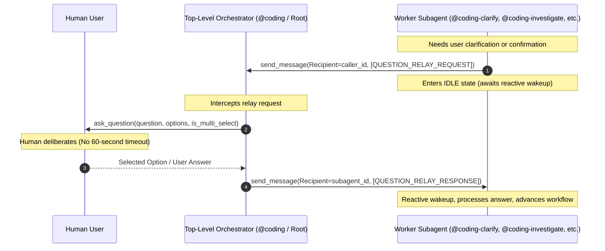
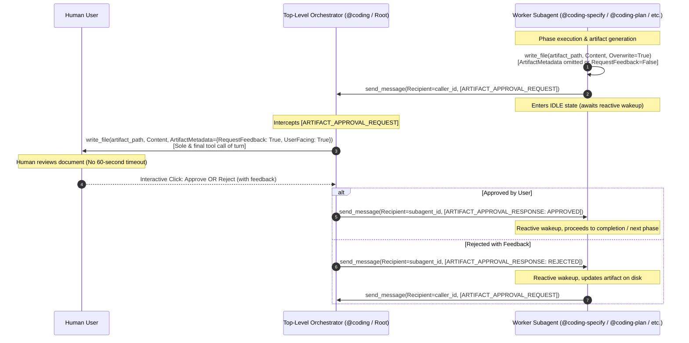

# AGENTS.md — Agentic Workspace Coordinator

Welcome to the **agentic** workspace. This repository serves as the central coordination hub for authoring, maintaining, and integrating **Google Antigravity** plugins, alongside an **Obsidian Vault** for cross-cutting documentation and session intelligence.

---

## 1. Workspace Architecture & Layout

This workspace uses a multi-repo model. The root `agentic` repository orchestrates individual sub-repositories and provides workspace-wide automation and guidelines.

```text
agentic/
├── AGENTS.md                 # This coordination guide & agent instructions
├── README.md                 # Human-facing workspace overview
├── Makefile                  # Multi-repo synchronization & workspace management
├── .gitignore                # Global workspace gitignore (ignores sub-repos)
├── scripts/                  # Workspace management and sync automation
│   ├── sync_sessions.py      # Session transcript -> Obsidian vault exporter
│   └── worktree.py           # Parallel session worktree manager
├── agentic-coding-plugin/    # Git Sub-repo: Antigravity coding companion plugin
│   ├── plugin.json           # Plugin manifest
│   ├── rules/AGENTS.md       # Plugin-scoped agent rules & guidelines
│   ├── skills/               # Reusable progressive-disclosure skills
│   ├── hooks/                # Lifecycle hooks
│   ├── mcp_config.json       # Plugin-provided MCP servers
│   └── README.md
├── agentic-issue-investigation-plugin/# Git Sub-repo: Multi-repo root cause diagnosis plugin
│   ├── plugin.json           # Plugin manifest
│   ├── rules/AGENTS.md       # Plugin-scoped investigation rules
│   ├── skills/               # Investigation runbooks (@coding-investigate)
│   ├── agents/               # Investigation subagent definition
│   └── README.md
├── agentic-project-documenting-plugin/# Git Sub-repo: Antigravity documentation companion plugin
│   ├── plugin.json           # Plugin manifest
│   ├── rules/AGENTS.md       # Plugin-scoped documentation rules
│   ├── skills/               # Vault documentation runbooks (@coding-document)
│   ├── agents/               # Documentation subagent definition
│   └── README.md
├── agentic-project-grooming-plugin/# Git Sub-repo: Interactive project initialization & grooming plugin
│   ├── plugin.json           # Plugin manifest
│   ├── rules/AGENTS.md       # Plugin-scoped grooming rules
│   ├── skills/               # Grooming runbook (/project-grooming)
│   └── README.md
├── agentic-prompt-triage-plugin/# Git Sub-repo: Dynamic prompt triage & intent classifier plugin
│   ├── plugin.json           # Plugin manifest
│   ├── rules/AGENTS.md       # Plugin-scoped triage rules
│   ├── hooks/                # PreInvocation dynamic triage hook
│   ├── hooks.json            # Lifecycle hook registration
│   └── README.md
├── agentic-task-monitoring-plugin/# Git Sub-repo: Antigravity telemetry & stream surveillance plugin
│   ├── plugin.json           # Plugin manifest
│   ├── rules/AGENTS.md       # Plugin-scoped monitoring rules
│   ├── skills/               # Monitoring runbooks (@coding-monitor)
│   ├── agents/               # Monitoring subagent definition
│   └── README.md
├── agentic-topic-researching-plugin/# Git Sub-repo: Autonomous deep web & literature research plugin
│   ├── plugin.json           # Plugin manifest
│   ├── rules/AGENTS.md       # Plugin-scoped research standards
│   ├── skills/               # Research runbooks (@coding-research)
│   ├── agents/               # Research subagent definition
│   └── README.md
└── agentic-obsidian/         # Git Sub-repo: Centralized Obsidian documentation vault
    ├── .obsidian/            # Obsidian workspace configuration
    ├── sessions/             # Formatted records of Antigravity agent sessions
    │   └── attachments/      # Artifacts and attachments linked to sessions
    ├── plugins/              # Documentation and specifications for each plugin
    ├── architecture/         # System designs, architecture decisions (ADRs)
    ├── templates/            # Obsidian note templates (sessions, plugins, ADRs)
    └── references/           # Antigravity APIs, SDK references, best practices
```

---

## 2. Antigravity Plugin Standards

All plugins within this ecosystem must adhere to the Antigravity Customization System standards:

### 2.1 File & Directory Conventions
- **Manifest (`plugin.json`)**: Every plugin must include a valid `plugin.json` at its root with `"name"` matching its directory name.
- **Rules (`rules/AGENTS.md`)**: Recommended location for plugin-specific instructions and rules. Merged into active rules when the plugin is active.
- **Skills (`skills/<skill_name>/SKILL.md`)**: Progressive-disclosure instructions with YAML frontmatter (`name`, `description`).
- **Hooks (`hooks.json` or `hooks/`)**: Lifecycle event handlers (pre-tool, post-tool, etc.). Native plugins must register `hooks.json` at root.
- **MCP Servers (`mcp_config.json`)**: Outlines MCP servers launched with the plugin, specifying command, args, and environment variables.

### 2.2 Isolation & Independence
- Each plugin and the Obsidian vault live in their own standalone Git repository, ignored by the root workspace `.gitignore`.
- Synchronization, bulk pulling, and cloning across repositories are managed via `Makefile` (`make sync`, `make pull`, `make push`, `make status`).
- Plugins can be versioned, tagged, and distributed independently or installed via `agy plugin install`.
- Avoid hardcoded machine-local paths; use relative paths within plugin bundles.

### 2.3 Plugin Ecosystem Catalog
The workspace currently hosts the following specialized plugins (all subagent handles start with `@coding`):
- **`agentic-coding-plugin`**: Structured full-lifecycle software development companion (`@coding`), coordinating 7-stage delivery workflows (`@coding-clarify`, `@coding-specify`, `@coding-plan`, `@coding-develop`, `@coding-deploy`, `@coding-review`, `@coding-merge`) with clean code reviews, Question Relay and Artifact Approval Relay Protocol inquiry routing, and documentation maintenance via `@coding-document` (after plan approval, before merging, and at the end of the lifecycle).
- **`agentic-issue-investigation-plugin`**: Autonomous multi-repository issue investigation and root-cause diagnosis subagent (`@coding-investigate`) with evidence-based verification, interactive approval gates, resolution handoff to `@coding`, and archival via `@coding-document`.
- **`agentic-project-documenting-plugin`**: Centralized documentation and knowledge curation companion (`@coding-document`), maintaining Obsidian vaults across projects, features, architecture designs, ADRs, session transcripts, artifacts, code changes, and git statuses.
- **`agentic-project-grooming-plugin`**: Interactive project initialization, backlog grooming, and scope boundary interrogation plugin (`/project-grooming`), conducting 7-category Matt Pocock grill-me interviews, interactive approval artifact authoring, and cross-plugin repository scaffolding.
- **`agentic-prompt-triage-plugin`**: High-performance prompt intent classifier and router using the Laya Router System 1 model to dynamically triage user requests across installed agentic plugins, omitting uninstalled plugin responses from evaluation.
- **`agentic-task-monitoring-plugin`**: Telemetry and stream surveillance subagent (`@coding-monitor`) with real-time log, Docker container, and serial stream monitoring, automatic anomaly detection, pause gates with `@coding-investigate` invocation, and session archival via `@coding-document`.
- **`agentic-topic-researching-plugin`**: Autonomous multi-query deep web and literature research subagent (`@coding-research`), featuring iterative query expansion, multi-source evidence extraction and cross-verification, structured citation tracking, interactive research report artifacts, and topic curation via `@coding-document`.

---

## 3. Cross-Plugin Awareness & Interoperability

### 3.1 Dynamic Companion Detection & Adaptation

The agentic workspace is designed modularly: users may install only a subset of plugins. Every plugin must gracefully detect companion plugins and adapt its workflow dynamically:

| Originating Plugin | Target Condition | Action / Decision Taken | Graceful Fallback if Not Installed |
| :--- | :--- | :--- | :--- |
| **`agentic-coding-plugin`** | `agentic-project-documenting-plugin` installed | Invoke `@coding-document` only after plan approval (Phase 3), before merging (Phase 5), and at the end (Phase 6) to maintain specs, ADRs, and git status. | Skip documentation step and proceed directly to subsequent development phase. |
| **`agentic-task-monitoring-plugin`** | `agentic-issue-investigation-plugin` installed | For each issue/anomaly discovered, ask user via `ask_question` if they want to invoke `@coding-investigate` to investigate root cause. | Present standard pause gate options (inspect code manually, restart, ignore, abort) without offering `@coding-investigate`. |
| **`agentic-task-monitoring-plugin`** | `agentic-project-documenting-plugin` installed | At the end of monitoring, invoke `@coding-document` to record monitoring session telemetry and alerts in `agentic-obsidian/monitoring/`. | Output monitoring telemetry summary directly in chat. |
| **`agentic-issue-investigation-plugin`** | `agentic-coding-plugin` installed | Once `issue-assessment.md` is approved, ask user via `ask_question` if they want to invoke `@coding` to implement the resolution. | Present manual implementation guidance, explaining `@coding` is not available. |
| **`agentic-issue-investigation-plugin`** | `agentic-project-documenting-plugin` installed | Once issue investigation is done, invoke `@coding-document` to archive `issue-assessment.md` in `agentic-obsidian/investigations/`. | Retain local session artifact `issue-assessment.md`. |
| **`agentic-project-grooming-plugin`** | `agentic-coding-plugin` installed | Once `Project_Request_Grooming.md` is approved, invoke `@coding` to coordinate multi-stage repo setup, code generation, and test verification. | Directly scaffold repository directories, initialize git, and write starter boilerplate. |
| **`agentic-project-grooming-plugin`** | `agentic-project-documenting-plugin` installed | Once `Project_Request_Grooming.md` is approved, invoke `@coding-document` to scaffold `<project>-obsidian/` vault and document architecture overview and ADRs. | Directly create baseline Obsidian directory structure and initial README. |
| **`agentic-topic-researching-plugin`** | `agentic-project-documenting-plugin` installed | Once `research-report.md` is approved, invoke `@coding-document` to record research in `agentic-obsidian/research/`, creating a new topic or updating an existing one. | Present research findings directly in chat. |
| **`agentic-prompt-triage-plugin`** | Plugin-specific evaluation | Only evaluate and include response choices for installed plugins (`agentic-coding-plugin` -> coding changes; `agentic-issue-investigation-plugin` -> investigations; `agentic-task-monitoring-plugin` -> monitoring; `agentic-project-grooming-plugin` -> project grooming; `agentic-topic-researching-plugin` -> research; `agentic-project-documenting-plugin` -> documentation). | Omit response candidate completely from triage options and Laya evaluation. |

### 3.2 Question Relay Protocol (Subagent User Inquiries)

#### 3.2.1 Problem Statement: 60-Second Subagent Timeout
In Google Antigravity, worker subagents spawned via `invoke_subagent` run inside background processes managed by the runtime. If a worker subagent executes `ask_question` directly, the runtime enforces a strict **60-second execution timeout** on the turn.

If human users deliberate, review technical options, or take longer than 60 seconds to respond, the subagent tool invocation throws a timeout exception, terminating the active workflow prematurely. Conversely, top-level orchestrators (`@coding` and root session turns) run without background tool execution timeouts and can await human input via `ask_question` indefinitely.

#### 3.2.2 Architectural Solution: Standardized Relay Protocol
To eliminate timeout failures while preserving interactive human-in-the-loop oversight, subagents must never call `ask_question` directly while under orchestrator control. Instead, subagents relay questions to their parent caller via `send_message` using standardized protocol envelopes:

1. **Subagent dispatches `[QUESTION_RELAY_REQUEST]`** via `send_message(Recipient=caller_id, Message=...)` and halts execution, entering an idle state.
2. **Parent Orchestrator intercepts request**, calls `ask_question` in the root turn (without any 60-second timeout), and captures the user's interactive response.
3. **Parent Orchestrator returns `[QUESTION_RELAY_RESPONSE]`** via `send_message(Recipient=subagent_id, Message=...)`.
4. **Subagent receives response**, is reactively awakened by the runtime, processes the answer, and advances its workflow.



#### 3.2.3 Message Envelopes & Schemas

##### Request Envelope: `[QUESTION_RELAY_REQUEST]`
Dispatched by the worker subagent to the parent orchestrator (`caller_id`):

```text
[QUESTION_RELAY_REQUEST]
```
```json
{
  "type": "QUESTION_RELAY_REQUEST",
  "questions": [
    {
      "question": "Which architecture pattern should we follow for the relay handler?",
      "options": [
        "(Recommended) Event-driven message listener hook in orchestrator loop",
        "Synchronous subagent blocking loop with sleep",
        "Direct callback via shared memory"
      ],
      "is_multi_select": false
    }
  ],
  "context": "Clarification needed for orchestrator-subagent interaction design."
}
```

*Rules*:
- `questions` array MUST contain exactly one question object to strictly enforce the "one question at a time" clarification principle.
- `options` MUST include clear choices with `(Recommended)` prefixing the recommended option when guidance is provided.
- `is_multi_select` defaults to `false`.

##### Response Envelope: `[QUESTION_RELAY_RESPONSE]`
Dispatched by the parent orchestrator back to the worker subagent (`subagent_id`):

```text
[QUESTION_RELAY_RESPONSE]
```
```json
{
  "type": "QUESTION_RELAY_RESPONSE",
  "answers": [
    "(Recommended) Event-driven message listener hook in orchestrator loop"
  ],
  "status": "COMPLETED"
}
```

*Rules*:
- `answers` contains the array of user-selected strings or custom user input text.
- `status` indicates outcome: `"COMPLETED"`, `"REJECTED"`, or `"CANCELLED"`.

#### 3.2.4 Pure Subagents vs. Dual-Mode Subagents

To ensure consistent enforcement across diverse subagents, agents are categorized into two tiers:

| Tier | Agents | Operating Protocol | Tooling Permissions |
| :--- | :--- | :--- | :--- |
| **Pure Subagents** | `@coding-clarify`<br>`@coding-deploy`<br>`@coding-review` | Strictly run under `@coding` orchestrator. **NEVER** call `ask_question`. Always dispatch `[QUESTION_RELAY_REQUEST]` to `caller_id` via `send_message`. | `send_message`<br>(Do not declare `ask_question`) |
| **Dual-Mode Agents** | `@coding-investigate`<br>`/project-grooming` (`@coding-groom`)<br>`@coding-monitor`<br>`@coding-research` | **Parent Caller Present**: Dispatch `[QUESTION_RELAY_REQUEST]` via `send_message` to caller.<br>**Standalone / Root**: Invoke `ask_question` directly when invoked at the top-level turn. | Both `send_message` and `ask_question` |

- **Pure Subagents Rules**:
  - Never declare or execute `ask_question`.
  - Package questions into `[QUESTION_RELAY_REQUEST]` and deliver via `send_message`.
  - Enter idle state and await reactive wakeup upon receiving `[QUESTION_RELAY_RESPONSE]`.
- **Dual-Mode Agents Rules**:
  - Dynamically inspect caller context (check if a parent caller ID is provided in session context/metadata).
  - When invoked by another agent (subagent mode), route all inquiries through `[QUESTION_RELAY_REQUEST]` via `send_message`.
  - When invoked directly by the user in a top-level session (standalone mode), execute `ask_question` directly without relaying.

### 3.3 Artifact Approval Relay Protocol (Subagent Artifact Gates)

#### 3.3.1 Problem Statement: 60-Second Subagent Timeout on Artifact Feedback
In Google Antigravity, worker subagents spawned via `invoke_subagent` run inside background processes managed by the runtime. If a worker subagent executes `write_file` with `ArtifactMetadata={"RequestFeedback": True, "UserFacing": True}`, the runtime awaits human interaction (Approve / Reject buttons) while the subagent's tool execution turn remains active. However, the runtime enforces a strict **60-second execution timeout** on background subagent tool invocations.

If human users deliberate, review technical specifications, inspect implementation plans, or take longer than 60 seconds to review the artifact, the subagent tool invocation throws a timeout exception, prematurely terminating the active workflow. Conversely, top-level orchestrators (`@coding` and root session turns) run in the foreground without background tool execution timeouts and can await human gate approval indefinitely.

#### 3.3.2 Architectural Solution: Root-Orchestrated Artifact Approval Relay
To eliminate timeout failures while preserving interactive human-in-the-loop oversight on artifacts:
1. **Worker Subagent writes artifact to disk** using `write_file(Path=artifact_path, Content=..., Overwrite=True)` without interactive gate metadata (`ArtifactMetadata` omitted or `RequestFeedback=False`).
2. **Subagent dispatches `[ARTIFACT_APPROVAL_REQUEST]`** via `send_message(Recipient=caller_id, Message=...)` containing the artifact path, stage, and summary, then halts execution and enters an idle state.
3. **Parent Orchestrator intercepts request**, reads the artifact from disk, and writes it in the root turn with `write_file(Path=artifact_path, Content=..., ArtifactMetadata={"RequestFeedback": True, "UserFacing": True})` as the **sole and final tool call** of that turn (without any 60-second timeout).
4. **Parent Orchestrator captures user decision**:
   - If **Approved**: Dispatches `[ARTIFACT_APPROVAL_RESPONSE]` with `status: "APPROVED"` to `subagent_id`.
   - If **Rejected**: Dispatches `[ARTIFACT_APPROVAL_RESPONSE]` with `status: "REJECTED"` and user feedback to `subagent_id`.
5. **Subagent receives response**, is reactively awakened by the runtime:
   - On approval: proceeds to completion or the next phase.
   - On rejection: reads user feedback, modifies the artifact on disk, and re-submits `[ARTIFACT_APPROVAL_REQUEST]`.



#### 3.3.3 Message Envelopes & Schemas

##### Request Envelope: `[ARTIFACT_APPROVAL_REQUEST]`
Dispatched by the worker subagent to the parent orchestrator (`caller_id`):

```text
[ARTIFACT_APPROVAL_REQUEST]
```
```json
{
  "type": "ARTIFACT_APPROVAL_REQUEST",
  "artifact_name": "specification.md",
  "artifact_path": "/Users/user/.gemini/antigravity/brain/<session-id>/specification.md",
  "stage": "SPECIFICATION",
  "summary": "Detailed technical specification for feature XYZ",
  "user_facing": true
}
```

*Fields*:
- `type`: Must be `"ARTIFACT_APPROVAL_REQUEST"`.
- `artifact_name`: Name of the artifact file (e.g., `specification.md`, `plan.md`, `deployment-issue.md`, `issue-assessment.md`, `Project_Request_Grooming.md`, `research-report.md`).
- `artifact_path`: Absolute path to the authored artifact on disk.
- `stage`: Lifecycle phase producing the artifact (e.g., `"SPECIFICATION"`, `"PLANNING"`, `"DEPLOYMENT_ISSUE"`, `"INVESTIGATION"`, `"GROOMING"`, `"RESEARCH"`).
- `summary`: Multi-line or detailed string describing the contents and purpose for `ArtifactMetadata.Summary`.
- `user_facing`: Boolean flag indicating whether `ArtifactMetadata.UserFacing` should be `true` (defaults to `true`).

##### Response Envelope: `[ARTIFACT_APPROVAL_RESPONSE]`
Dispatched by the parent orchestrator back to the worker subagent (`subagent_id`):

```text
[ARTIFACT_APPROVAL_RESPONSE]
```
```json
{
  "type": "ARTIFACT_APPROVAL_RESPONSE",
  "artifact_name": "specification.md",
  "status": "APPROVED",
  "feedback": ""
}
```

*Fields*:
- `type`: Must be `"ARTIFACT_APPROVAL_RESPONSE"`.
- `artifact_name`: Name of the artifact corresponding to the request.
- `status`: Outcome of the user review gate (`"APPROVED"` or `"REJECTED"`).
- `feedback`: User feedback string provided when rejected (or empty string if approved without comment).

#### 3.3.4 Pure Subagents vs. Dual-Mode Subagents Matrix

| Tier | Agents | Artifacts Produced | Operating Protocol | Tooling & Artifact Gate Permissions |
| :--- | :--- | :--- | :--- | :--- |
| **Pure Subagents** | `@coding-specify`<br>`@coding-plan`<br>`@coding-deploy` | `specification.md`<br>`plan.md`<br>`deployment-issue.md` | Strictly run under `@coding` orchestrator. **NEVER** write artifacts with `RequestFeedback=True`. Always write to disk without feedback gate and dispatch `[ARTIFACT_APPROVAL_REQUEST]` to `caller_id` via `send_message`. | `write_file` (without `RequestFeedback=True`), `send_message` |
| **Dual-Mode Agents** | `@coding-investigate`<br>`/project-grooming` (`@coding-groom`)<br>`@coding-research` | `issue-assessment.md`<br>`Project_Request_Grooming.md`<br>`research-report.md` | **Parent Caller Present**: Write artifact to disk without `RequestFeedback=True`, dispatch `[ARTIFACT_APPROVAL_REQUEST]` via `send_message` to caller.<br>**Standalone / Root**: Author artifact directly using `write_file` with `ArtifactMetadata={"RequestFeedback": True, "UserFacing": True}` as the sole & final tool call of the turn. | `write_file` (with or without `RequestFeedback`), `send_message` |

- **Pure Subagents Rules**:
  - Never call `write_file` with `ArtifactMetadata={"RequestFeedback": True, ...}`.
  - Package artifact approval requests into `[ARTIFACT_APPROVAL_REQUEST]` and deliver via `send_message`.
  - Enter idle state and await reactive wakeup upon receiving `[ARTIFACT_APPROVAL_RESPONSE]`.
- **Dual-Mode Agents Rules**:
  - Dynamically inspect caller context (check if a parent caller ID is provided in session context/metadata).
  - When invoked by another agent (subagent mode), write artifact without feedback gate and route approval through `[ARTIFACT_APPROVAL_REQUEST]` via `send_message`.
  - When invoked directly by the user in a top-level session (standalone mode), execute `write_file` with `ArtifactMetadata={"RequestFeedback": True, "UserFacing": True}` directly as the sole and final tool call of the turn.

---

## 4. Coding Workflow Pipeline & Decision Flowchart

The software development lifecycle coordinates specialized `@coding-*` subagents across 7 distinct phases with strict approval gates, local deployment verification, and Question Relay / Artifact Approval Relay Protocol inquiry routing:

```mermaid
flowchart TD
    %% Top Entrypoint
    Start(["User Request / Task"]) --> P1["Phase 1: Clarification<br/>(@coding-clarify)"]
    
    %% Phase 1: Clarification
    P1 --> AmbiguityCheck{"Ambiguities or<br/>Open Questions?"}
    AmbiguityCheck -->|"Yes"| GrillUser["Relay Question to User<br/>([QUESTION_RELAY_REQUEST] -> ask_question<br/>-> [QUESTION_RELAY_RESPONSE])"]
    GrillUser --> P1
    AmbiguityCheck -->|"No / Clarified"| P2["Phase 2: Specification<br/>(@coding-specify)"]

    %% Phase 2: Specification
    P2 --> SpecRelay["Write specification.md to disk & relay<br/>([ARTIFACT_APPROVAL_REQUEST] -> @coding root<br/>write_file(RequestFeedback=True))"]
    SpecRelay --> IdleSpec["Await User Decision<br/>(Root Gate: No Timeout)"]
    IdleSpec --> SpecGate{"User Decision on<br/>specification.md?"}
    SpecGate -->|"[GATE_APPROVED]"| P3["Phase 3: Planning<br/>(@coding-plan)"]

    %% Phase 3: Planning
    P3 --> PlanRelay["Write plan.md to disk & relay<br/>([ARTIFACT_APPROVAL_REQUEST] -> @coding root<br/>write_file(RequestFeedback=True))"]
    PlanRelay --> IdlePlan["Await User Decision<br/>(Root Gate: No Timeout)"]
    IdlePlan --> PlanGate{"User Decision on<br/>plan.md?"}
    PlanGate -->|"[GATE_APPROVED]"| DocPlanCheck{"agentic-project-documenting-plugin<br/>installed?"}
    DocPlanCheck -->|"Yes"| InvokeDocPlan["Invoke @coding-document<br/>(Document architecture plan & ADRs)"]
    DocPlanCheck -->|"No"| P4["Phase 4: Development<br/>(@coding-develop)"]
    InvokeDocPlan --> P4

    %% Phase 4: Development & Phase 5: Local Deployment (Per-Repo)
    P4 --> ParallelDev["Fan out parallel workers<br/>per repo on isolated branches"]
    ParallelDev --> DevWork["Implement code, tests, linting<br/>Return DevelopReport"]
    DevWork --> DeployCheck{"Local deployment<br/>instructions exist?"}
    DeployCheck -->|"Yes"| P5Deploy["Phase 5: Local Deployment<br/>(@coding-deploy per repo)"]
    DeployCheck -->|"No"| JoinDevDeploy["Synchronize Deliverables<br/>(All develop & deploy done)"]

    %% Phase 5: Deployment Execution, Monitoring & Error Loop
    P5Deploy --> DeployRun["Execute local deploy & monitor health"]
    DeployRun --> DeploySuccess{"Deployment<br/>Successful?"}
    DeploySuccess -->|"Yes"| JoinDevDeploy
    DeploySuccess -->|"Error"| DeployIssueRelay["Write deployment-issue.md & relay<br/>([ARTIFACT_APPROVAL_REQUEST] -> @coding root<br/>write_file(RequestFeedback=True))"]
    DeployIssueRelay --> DeployGate{"User Decision on<br/>Deployment Issue?"}
    DeployGate -->|"Approved"| MultiSolCheck{"Multiple solutions<br/>proposed?"}
    MultiSolCheck -->|"Yes"| AskSol["Relay solution choice<br/>([QUESTION_RELAY_REQUEST] -> ask_question<br/>-> [QUESTION_RELAY_RESPONSE])"]
    MultiSolCheck -->|"Single"| InvokeFixDev["Invoke @coding-develop<br/>to implement fix"]
    AskSol --> InvokeFixDev
    InvokeFixDev --> P5Deploy
    DeployGate -->|"Rejected"| AbortWorkflow(["Abort / Terminate"])

    %% Phase 6: Review
    JoinDevDeploy --> P6Review["Phase 6: Review<br/>(@coding-review)"]
    P6Review --> AuditChanges["Audit deliverables & deployment<br/>Run verification test suites"]
    AuditChanges --> ReviewCheck{"Quality Audit<br/>Passed?"}
    ReviewCheck -->|"Passed"| MergeConfirmGate{"Confirm Merge with User<br/>(ask_question directly or relayed via<br/>[QUESTION_RELAY_REQUEST])"}
    MergeConfirmGate -->|"User Confirmed"| DocPreMergeCheck{"agentic-project-documenting-plugin<br/>installed?"}
    DocPreMergeCheck -->|"Yes"| InvokeDocPreMerge["Invoke @coding-document<br/>(Pre-merge tidy-up: update READMEs & architecture docs)"]
    DocPreMergeCheck -->|"No"| P7Merge["Phase 7: Merge & Release<br/>(@coding-merge)"]
    InvokeDocPreMerge --> P7Merge

    %% Phase 7: Release & Merge
    P7Merge --> ExecMerge["Wait for all develop & deploy<br/>Execute git merge or open GitHub PR"]
    ExecMerge --> DocPostMergeCheck{"agentic-project-documenting-plugin<br/>installed?"}
    DocPostMergeCheck -->|"Yes"| InvokeDocPostMerge["Invoke @coding-document<br/>(Post-merge: update git status, branch tracking & changelogs)"]
    DocPostMergeCheck -->|"No"| Complete(["Workflow Completed"])
    InvokeDocPostMerge --> Complete

    %% Rejection & Rework Loops (routing upward)
    SpecGate -->|"[GATE_REJECTED]"| P1
    PlanGate -->|"[GATE_REJECTED]"| P1
    ReviewCheck -->|"Defects Found"| P3

    %% User Denied Merge routes directly to bottom termination
    MergeConfirmGate -->|"User Denied"| AbortWorkflow
```



### 4.1 Phase Lifecycle & Relay Checkpoints

1. **Phase 1: Clarification (`@coding-clarify`)**:
   - Conducts single-question user interrogation across scope, requirements, edge cases, and non-goals.
   - **Question Relay Interaction**: Rather than calling `ask_question` directly, dispatches `[QUESTION_RELAY_REQUEST]` envelopes via `send_message`. The `@coding` orchestrator executes `ask_question` in the root turn and replies with `[QUESTION_RELAY_RESPONSE]`.
2. **Phase 2: Specification (`@coding-specify`)**:
   - Synthesizes findings and writes `specification.md` to disk without interactive feedback metadata.
   - **Artifact Approval Relay Interaction**: Rather than calling `write_file` with `RequestFeedback=True` (which risks the 60-second subagent timeout), dispatches `[ARTIFACT_APPROVAL_REQUEST]` to `@coding`. The `@coding` orchestrator presents `specification.md` at the root turn with `RequestFeedback=True` as its sole and final tool call. Enters IDLE state awaiting `[ARTIFACT_APPROVAL_RESPONSE]` (`"APPROVED"` advances to Phase 3; `"REJECTED"` receives feedback and updates the specification).
3. **Phase 3: Planning (`@coding-plan`)**:
   - Decomposes work per repository, determines isolated branches (`feature/*`, `task/*`, `bugfix/*`), assesses local deployment needs, and writes `plan.md` to disk.
   - **Artifact Approval Relay Interaction**: Dispatches `[ARTIFACT_APPROVAL_REQUEST]` to `@coding`. The orchestrator presents the interactive approval gate for `plan.md` at the root turn. Upon `[ARTIFACT_APPROVAL_RESPONSE]` with `"APPROVED"`, invokes `@coding-document` if installed before advancing to Phase 4.
4. **Phase 4: Development (`@coding-develop`)**:
   - Fans out parallel worker subagents per repository. Workers implement code, author unit/integration tests, run linters, and return a structured `DevelopReport`.
5. **Phase 5: Local Deployment (`@coding-deploy`)**:
   - Executes and monitors local deployments (Docker, Docker Compose, Minikube, scripts) for repositories requiring runtime verification.
   - **Deployment Issue Artifact Relay**: If deployment fails, `@coding-deploy` analyzes logs, writes `deployment-issue.md` to disk without interactive feedback metadata, and dispatches `[ARTIFACT_APPROVAL_REQUEST]` to `@coding`. The root orchestrator presents the interactive gate without subagent timeout risk.
   - **Question Relay Interaction**: When deployment remediations offer multiple solutions, `@coding-deploy` dispatches a `[QUESTION_RELAY_REQUEST]` to `@coding`. The orchestrator prompts the user and returns the chosen remediation in `[QUESTION_RELAY_RESPONSE]` before invoking `@coding-develop` to fix.
6. **Phase 6: Quality Review & Audit (`@coding-review`)**:
   - Audits deliverables against specification, verifies code quality, test suite execution, and local deployment health.
   - **Question Relay Interaction**: Merge confirmation is prompted either directly by `@coding` via `ask_question` or relayed by `@coding-review` through `[QUESTION_RELAY_REQUEST]`.
7. **Phase 7: Merging & Release (`@coding-merge`)**:
   - Coordinates pre-merge documentation tidy-up via `@coding-document`, merges branches, and updates release changelogs and git status tracking.

---

## 5. Multi-Repository Management (Makefile)

The root repository coordinates all sub-repositories via [`Makefile`](file:///Users/gpfister/Development/Projects/gpfister/agentic/Makefile):

| Target | Description |
| :--- | :--- |
| `make sync` | Clones any missing repositories, pulls latest updates (fast-forward) across all repos, and prints status overview. |
| `make clone` | Clones missing sub-repositories (`agentic-*-plugin`, `agentic-obsidian`). Supports `GITHUB_ORG` and `GIT_PROTOCOL` (ssh/https). |
| `make pull` | Fast-forwards all sub-repositories and the root repository. |
| `make push` | Pushes current branch commits to origin across all repositories. |
| `make status` (or `make st`) | Displays clean/dirty indicators, current branches, and ahead/behind counts for all repositories. |
| `make diff` | Displays uncommitted changes across all repositories. |
| `make worktrees` | Lists active Git worktrees. |
| `make sessions` | Synchronizes the latest Antigravity session into the Obsidian vault. |

---

## 6. Obsidian Vault & Session Tracking Protocol

The `agentic-obsidian/` repository serves as the knowledge base for documentation, architectural decisions, and agent interaction telemetry.

### 6.1 Session Tracking
Antigravity stores session data in `~/.gemini/antigravity-cli/brain/<conversation-id>/`. Every significant session should be recorded into `agentic-obsidian/sessions/<conversation-id>.md`.

Each session note must include:
1. **YAML Frontmatter**:
   ```yaml
   ---
   session_id: "<UUID>"
   title: "Descriptive Session Title"
   date: "YYYY-MM-DD HH:MM:SS"
   model: "Gemini 3.8 Flash (or active model)"
   status: "Completed | In-Progress"
   tags:
     - antigravity-session
     - plugin-dev
   tools_used:
     - run_command
     - write_file
     - ask_question
   step_count: 35
   artifacts:
     - "brain_artifact_1.md"
   ---
   ```
2. **Executive Summary**: Goals, actions taken, and outcomes.
3. **Tasks & Decisions**: High-level milestones and key design choices.
4. **Tool Invocations & Reasoning**: Collapsible callouts (`> [!example]- Reasoning Step X` or markdown `<details>`) detailing tool calls and internal chain of thought.
5. **Artifacts & File Changes**: Copies or links to artifacts created during the session.

### 6.2 Syncing Sessions
Use the bundled Python script to parse and export transcripts into the vault:

```bash
# Sync current / specific session by ID:
python3 scripts/sync_sessions.py <session-id>

# Sync the most recent session automatically:
python3 scripts/sync_sessions.py --latest

# Sync all sessions in the brain directory:
python3 scripts/sync_sessions.py --all
```

---

## 7. Parallel Sessions & Git Worktrees

To run multiple Antigravity sessions in parallel without branch contention or working directory conflicts, use Git worktrees. Worktrees are isolated under `.worktrees/<session-id>/` and ignored by Git across all repositories.

### 7.1 Worktree Management Script
Use `scripts/worktree.py` to create, inspect, and remove parallel session workspaces:

```bash
# List all active worktrees across root and sub-repos:
python3 scripts/worktree.py list

# Create an isolated worktree for a session (across all repos):
python3 scripts/worktree.py create <session-id-or-feature>

# Create a worktree for a specific plugin only:
python3 scripts/worktree.py create <session-id-or-feature> --repo agentic-coding-plugin

# Remove a worktree session after completion (and optionally delete branches):
python3 scripts/worktree.py remove <session-id-or-feature> -D

# Prune stale worktree metadata:
python3 scripts/worktree.py prune
```

### 7.2 Parallel Session Protocol
1. Each parallel Antigravity session can operate in `.worktrees/<session-id>/...` or on its dedicated session branch (`session/<session-id>-<repo>`).
2. Vault session logs remain keyed by the unique `<session-id>` in `agentic-obsidian/sessions/<session-id>.md`, preventing collision even when multiple agents write logs simultaneously.
3. Once a parallel session concludes, changes can be merged back to `master` and the worktree cleanly removed.

---

## 8. Agent Operational Instructions

When an Antigravity agent operates in this workspace:
1. **Identify the Scope**:
   - If working on a specific plugin (e.g. `agentic-coding-plugin/`), follow that plugin's internal `rules/AGENTS.md` and keep commits isolated to that plugin's git repository.
   - If working across plugins or global setup, follow this root `AGENTS.md`.
2. **Update Documentation**:
   - When introducing or altering a plugin, update `agentic-obsidian/plugins/<plugin-name>.md`.
   - When recording architectural decisions or standards, write to `agentic-obsidian/architecture/`.
3. **Session Record Keeping**:
   - At the conclusion of major tasks or upon user request, trigger `scripts/sync_sessions.py` to archive the current conversation state into `agentic-obsidian/sessions/`.
4. **Code Quality & Links**:
   - Always create clickable markdown links using `file://` scheme when referencing files and code symbols.
