# AGENTS.md — Agentic Workspace Coordinator

Welcome to the **agentic** workspace. This repository serves as the central coordination hub for authoring, maintaining, and integrating **Google Antigravity** plugins, alongside an **Obsidian Vault** for cross-cutting documentation and session intelligence.

---

## 1. Workspace Architecture & Layout

This workspace uses a multi-repo model. The root `agentic` repository orchestrates individual sub-repositories and provides workspace-wide automation and guidelines.

```text
agentic/
├── AGENTS.md                 # This coordination guide & agent instructions
├── README.md                 # Human-facing workspace overview
├── Makefile                  # Multi-repo synchronization & workspace management
├── .gitignore                # Global workspace gitignore (ignores sub-repos)
├── scripts/                  # Workspace management and sync automation
│   ├── sync_sessions.py      # Session transcript -> Obsidian vault exporter
│   └── worktree.py           # Parallel session worktree manager
├── agentic-coding-plugin/    # Git Sub-repo: Antigravity coding companion plugin
│   ├── plugin.json           # Plugin manifest
│   ├── rules/AGENTS.md       # Plugin-scoped agent rules & guidelines
│   ├── skills/               # Reusable progressive-disclosure skills
│   ├── hooks/                # Lifecycle hooks
│   ├── mcp_config.json       # Plugin-provided MCP servers
│   └── README.md
├── agentic-document-plugin/  # Git Sub-repo: Antigravity documentation companion plugin
│   ├── plugin.json           # Plugin manifest
│   ├── rules/AGENTS.md       # Plugin-scoped documentation rules
│   ├── skills/               # Vault documentation runbooks (@coding-document)
│   ├── agents/               # Documentation subagent definition
│   └── README.md
├── agentic-investigate-plugin/# Git Sub-repo: Multi-repo root cause diagnosis plugin
│   ├── plugin.json           # Plugin manifest
│   ├── rules/AGENTS.md       # Plugin-scoped investigation rules
│   ├── skills/               # Investigation runbooks (@coding-investigate)
│   ├── agents/               # Investigation subagent definition
│   └── README.md
├── agentic-monitor-plugin/   # Git Sub-repo: Antigravity telemetry & stream surveillance plugin
│   ├── plugin.json           # Plugin manifest
│   ├── rules/AGENTS.md       # Plugin-scoped monitoring rules
│   ├── skills/               # Monitoring runbooks (@coding-monitor)
│   ├── agents/               # Monitoring subagent definition
│   └── README.md
├── agentic-research-plugin/  # Git Sub-repo: Autonomous deep web & literature research plugin
│   ├── plugin.json           # Plugin manifest
│   ├── rules/AGENTS.md       # Plugin-scoped research standards
│   ├── skills/               # Research runbooks (@coding-research)
│   ├── agents/               # Research subagent definition
│   └── README.md
├── agentic-triage-plugin/    # Git Sub-repo: Dynamic prompt triage & intent classifier plugin
│   ├── plugin.json           # Plugin manifest
│   ├── rules/AGENTS.md       # Plugin-scoped triage rules
│   ├── hooks/                # PreInvocation dynamic triage hook
│   ├── hooks.json            # Lifecycle hook registration
│   └── README.md
└── agentic-obsidian/         # Git Sub-repo: Centralized Obsidian documentation vault
    ├── .obsidian/            # Obsidian workspace configuration
    ├── sessions/             # Formatted records of Antigravity agent sessions
    │   └── attachments/      # Artifacts and attachments linked to sessions
    ├── plugins/              # Documentation and specifications for each plugin
    ├── architecture/         # System designs, architecture decisions (ADRs)
    ├── templates/            # Obsidian note templates (sessions, plugins, ADRs)
    └── references/           # Antigravity APIs, SDK references, best practices
```

---

## 2. Antigravity Plugin Standards

All plugins within this ecosystem must adhere to the Antigravity Customization System standards:

### 2.1 File & Directory Conventions
- **Manifest (`plugin.json`)**: Every plugin must include a valid `plugin.json` at its root with `"name"` matching its directory name.
- **Rules (`rules/AGENTS.md`)**: Recommended location for plugin-specific instructions and rules. Merged into active rules when the plugin is active.
- **Skills (`skills/<skill_name>/SKILL.md`)**: Progressive-disclosure instructions with YAML frontmatter (`name`, `description`).
- **Hooks (`hooks.json` or `hooks/`)**: Lifecycle event handlers (pre-tool, post-tool, etc.). Native plugins must register `hooks.json` at root.
- **MCP Servers (`mcp_config.json`)**: Outlines MCP servers launched with the plugin, specifying command, args, and environment variables.

### 2.2 Isolation & Independence
- Each plugin and the Obsidian vault live in their own standalone Git repository, ignored by the root workspace `.gitignore`.
- Synchronization, bulk pulling, and cloning across repositories are managed via `Makefile` (`make sync`, `make pull`, `make push`, `make status`).
- Plugins can be versioned, tagged, and distributed independently or installed via `agy plugin install`.
- Avoid hardcoded machine-local paths; use relative paths within plugin bundles.

### 2.3 Plugin Ecosystem Catalog
The workspace currently hosts the following specialized plugins (all subagent handles start with `@coding`):
- **`agentic-coding-plugin`**: Structured full-lifecycle software development companion (`@coding`), coordinating 6-stage delivery workflows (`@coding-clarify`, `@coding-specify`, `@coding-plan`, `@coding-develop`, `@coding-review`, `@coding-merge`) with clean code reviews and after-each-phase documentation maintenance via `@coding-document`.
- **`agentic-document-plugin`**: Centralized documentation and knowledge curation companion (`@coding-document`), maintaining Obsidian vaults across projects, features, architecture designs, ADRs, session transcripts, artifacts, code changes, and git statuses.
- **`agentic-investigate-plugin`**: Autonomous multi-repository issue investigation and root-cause diagnosis subagent (`@coding-investigate`) with evidence-based verification, interactive approval gates, resolution handoff to `@coding`, and archival via `@coding-document`.
- **`agentic-monitor-plugin`**: Telemetry and stream surveillance subagent (`@coding-monitor`) with real-time log, Docker container, and serial stream monitoring, automatic anomaly detection, pause gates with `@coding-investigate` invocation, and session archival via `@coding-document`.
- **`agentic-research-plugin`**: Autonomous multi-query deep web and literature research subagent (`@coding-research`), featuring iterative query expansion, multi-source evidence extraction and cross-verification, structured citation tracking, interactive research report artifacts, and topic curation via `@coding-document`.
- **`agentic-triage-plugin`**: High-performance prompt intent classifier and router using the Laya Router System 1 model to dynamically triage user requests across installed agentic plugins, omitting uninstalled plugin responses from evaluation.

---

## 3. Cross-Plugin Awareness & Interoperability

The agentic workspace is designed modularly: users may install only a subset of plugins. Every plugin must gracefully detect companion plugins and adapt its workflow dynamically:

| Originating Plugin | Target Condition | Action / Decision Taken | Graceful Fallback if Not Installed |
| :--- | :--- | :--- | :--- |
| **`agentic-coding-plugin`** | `agentic-document-plugin` installed | Invoke `@coding-document` after **each phase** (Clarify, Specify, Plan, Develop, Review, Merge) to maintain specs, ADRs, test notes, and git status. | Skip documentation step and proceed directly to subsequent development phase. |
| **`agentic-monitor-plugin`** | `agentic-investigate-plugin` installed | For each issue/anomaly discovered, ask user via `ask_question` if they want to invoke `@coding-investigate` to investigate root cause. | Present standard pause gate options (inspect code manually, restart, ignore, abort) without offering `@coding-investigate`. |
| **`agentic-monitor-plugin`** | `agentic-document-plugin` installed | At the end of monitoring, invoke `@coding-document` to record monitoring session telemetry and alerts in `agentic-obsidian/monitoring/`. | Output monitoring telemetry summary directly in chat. |
| **`agentic-investigate-plugin`** | `agentic-coding-plugin` installed | Once `issue-assessment.md` is approved, ask user via `ask_question` if they want to invoke `@coding` to implement the resolution. | Present manual implementation guidance, explaining `@coding` is not available. |
| **`agentic-investigate-plugin`** | `agentic-document-plugin` installed | Once issue investigation is done, invoke `@coding-document` to archive `issue-assessment.md` in `agentic-obsidian/investigations/`. | Retain local session artifact `issue-assessment.md`. |
| **`agentic-research-plugin`** | `agentic-document-plugin` installed | Once `research-report.md` is approved, invoke `@coding-document` to record research in `agentic-obsidian/research/`, creating a new topic or updating an existing one. | Present research findings directly in chat. |
| **`agentic-triage-plugin`** | Plugin-specific evaluation | Only evaluate and include response choices for installed plugins (`agentic-coding-plugin` -> coding changes; `agentic-monitor-plugin` -> monitoring; `agentic-investigate-plugin` -> investigations; `agentic-research-plugin` -> research; `agentic-document-plugin` -> documentation). | Omit response candidate completely from triage options and Laya evaluation. |

---

## 4. Coding Workflow Pipeline & Decision Flowchart

The software development lifecycle coordinates specialized `@coding-*` subagents across 6 distinct phases with strict approval gates and idle guards:

```mermaid
flowchart TD
    %% Top Entrypoint
    Start(["User Request / Task"]) --> P1["Phase 1: Clarification<br/>(@coding-clarify)"]
    
    %% Phase 1: Clarification
    P1 --> AmbiguityCheck{"Ambiguities or<br/>Open Questions?"}
    AmbiguityCheck -->|"Yes"| GrillUser["Interrogate User via ask_question<br/>(One question at a time)"]
    GrillUser --> P1
    AmbiguityCheck -->|"No / Clarified"| Doc1Check{"agentic-document-plugin<br/>installed?"}
    Doc1Check -->|"Yes"| InvokeDoc1["Invoke @coding-document<br/>(Document requirements & clarification notes)"]
    Doc1Check -->|"No"| P2["Phase 2: Specification<br/>(@coding-specify)"]
    InvokeDoc1 --> P2

    %% Phase 2: Specification
    P2 --> SpecArtifact["Write specification.md<br/>(RequestFeedback=True, sole tool call)"]
    SpecArtifact --> IdleSpec["Enter IDLE State<br/>(Wait for User Gate Decision)"]
    IdleSpec --> SpecGate{"User Decision on<br/>specification.md?"}
    SpecGate -->|"[GATE_APPROVED]"| Doc2Check{"agentic-document-plugin<br/>installed?"}
    Doc2Check -->|"Yes"| InvokeDoc2["Invoke @coding-document<br/>(Document & index feature specifications)"]
    Doc2Check -->|"No"| P3["Phase 3: Planning<br/>(@coding-plan)"]
    InvokeDoc2 --> P3

    %% Phase 3: Planning
    P3 --> PlanArtifact["Write plan.md<br/>(RequestFeedback=True, sole tool call)"]
    PlanArtifact --> IdlePlan["Enter IDLE State<br/>(Wait for User Gate Decision)"]
    IdlePlan --> PlanGate{"User Decision on<br/>plan.md?"}
    PlanGate -->|"[GATE_APPROVED]"| Doc3Check{"agentic-document-plugin<br/>installed?"}
    Doc3Check -->|"Yes"| InvokeDoc3["Invoke @coding-document<br/>(Document architecture plan & ADRs)"]
    Doc3Check -->|"No"| P4["Phase 4: Development<br/>(@coding-develop)"]
    InvokeDoc3 --> P4

    %% Phase 4: Development
    P4 --> ParallelDev["Fan out parallel workers<br/>per repo on isolated branches"]
    ParallelDev --> DevWork["Implement code, tests, linting<br/>Return DevelopReport"]
    DevWork --> Doc4Check{"agentic-document-plugin<br/>installed?"}
    Doc4Check -->|"Yes"| InvokeDoc4["Invoke @coding-document<br/>(Document code changes & implementation notes)"]
    Doc4Check -->|"No"| P5["Phase 5: Review<br/>(@coding-review)"]
    InvokeDoc4 --> P5

    %% Phase 5: Review
    P5 --> AuditChanges["Audit deliverables against spec<br/>Run verification test suites"]
    AuditChanges --> ReviewCheck{"Quality Audit<br/>Passed?"}
    ReviewCheck -->|"Passed"| MergeConfirmGate{"Confirm Merge with User<br/>(ask_question)"}
    MergeConfirmGate -->|"User Confirmed"| Doc5Check{"agentic-document-plugin<br/>installed?"}
    Doc5Check -->|"Yes"| InvokeDoc5["Invoke @coding-document<br/>(Pre-merge tidy-up: update READMEs & architecture docs)"]
    Doc5Check -->|"No"| P6["Phase 6: Merge & Release<br/>(@coding-merge)"]
    InvokeDoc5 --> P6

    %% Phase 6: Release & Merge
    P6 --> ExecMerge["Execute git merge or open GitHub PR"]
    ExecMerge --> Doc6Check{"agentic-document-plugin<br/>installed?"}
    Doc6Check -->|"Yes"| InvokeDoc6["Invoke @coding-document<br/>(Post-merge: update git status, branch tracking & changelogs)"]
    Doc6Check -->|"No"| Complete(["Workflow Completed"])
    InvokeDoc6 --> Complete

    %% Rejection & Rework Loops (routing upward)
    SpecGate -->|"[GATE_REJECTED]"| P1
    PlanGate -->|"[GATE_REJECTED]"| P1
    ReviewCheck -->|"Defects Found"| P3

    %% User Denied Merge routes directly to bottom termination
    MergeConfirmGate -->|"User Denied"| AbortWorkflow(["Abort / Terminate"])
```



---

## 3. Multi-Repository Management (Makefile)

The root repository coordinates all sub-repositories via [`Makefile`](file:///Users/gpfister/Development/Projects/gpfister/agentic/Makefile):

| Target | Description |
| :--- | :--- |
| `make sync` | Clones any missing repositories, pulls latest updates (fast-forward) across all repos, and prints status overview. |
| `make clone` | Clones missing sub-repositories (`agentic-*-plugin`, `agentic-obsidian`). Supports `GITHUB_ORG` and `GIT_PROTOCOL` (ssh/https). |
| `make pull` | Fast-forwards all sub-repositories and the root repository. |
| `make push` | Pushes current branch commits to origin across all repositories. |
| `make status` (or `make st`) | Displays clean/dirty indicators, current branches, and ahead/behind counts for all repositories. |
| `make diff` | Displays uncommitted changes across all repositories. |
| `make worktrees` | Lists active Git worktrees. |
| `make sessions` | Synchronizes the latest Antigravity session into the Obsidian vault. |

---

## 4. Obsidian Vault & Session Tracking Protocol

The `agentic-obsidian/` repository serves as the knowledge base for documentation, architectural decisions, and agent interaction telemetry.

### 3.1 Session Tracking
Antigravity stores session data in `~/.gemini/antigravity-cli/brain/<conversation-id>/`. Every significant session should be recorded into `agentic-obsidian/sessions/<conversation-id>.md`.

Each session note must include:
1. **YAML Frontmatter**:
   ```yaml
   ---
   session_id: "<UUID>"
   title: "Descriptive Session Title"
   date: "YYYY-MM-DD HH:MM:SS"
   model: "Gemini 3.8 Flash (or active model)"
   status: "Completed | In-Progress"
   tags:
     - antigravity-session
     - plugin-dev
   tools_used:
     - run_command
     - write_file
     - ask_question
   step_count: 35
   artifacts:
     - "brain_artifact_1.md"
   ---
   ```
2. **Executive Summary**: Goals, actions taken, and outcomes.
3. **Tasks & Decisions**: High-level milestones and key design choices.
4. **Tool Invocations & Reasoning**: Collapsible callouts (`> [!example]- Reasoning Step X` or markdown `<details>`) detailing tool calls and internal chain of thought.
5. **Artifacts & File Changes**: Copies or links to artifacts created during the session.

### 3.2 Syncing Sessions
Use the bundled Python script to parse and export transcripts into the vault:

```bash
# Sync current / specific session by ID:
python3 scripts/sync_sessions.py <session-id>

# Sync the most recent session automatically:
python3 scripts/sync_sessions.py --latest

# Sync all sessions in the brain directory:
python3 scripts/sync_sessions.py --all
```

---

## 5. Parallel Sessions & Git Worktrees

To run multiple Antigravity sessions in parallel without branch contention or working directory conflicts, use Git worktrees. Worktrees are isolated under `.worktrees/<session-id>/` and ignored by Git across all repositories.

### 4.1 Worktree Management Script
Use `scripts/worktree.py` to create, inspect, and remove parallel session workspaces:

```bash
# List all active worktrees across root and sub-repos:
python3 scripts/worktree.py list

# Create an isolated worktree for a session (across all repos):
python3 scripts/worktree.py create <session-id-or-feature>

# Create a worktree for a specific plugin only:
python3 scripts/worktree.py create <session-id-or-feature> --repo agentic-coding-plugin

# Remove a worktree session after completion (and optionally delete branches):
python3 scripts/worktree.py remove <session-id-or-feature> -D

# Prune stale worktree metadata:
python3 scripts/worktree.py prune
```

### 4.2 Parallel Session Protocol
1. Each parallel Antigravity session can operate in `.worktrees/<session-id>/...` or on its dedicated session branch (`session/<session-id>-<repo>`).
2. Vault session logs remain keyed by the unique `<session-id>` in `agentic-obsidian/sessions/<session-id>.md`, preventing collision even when multiple agents write logs simultaneously.
3. Once a parallel session concludes, changes can be merged back to `master` and the worktree cleanly removed.

---

## 6. Agent Operational Instructions

When an Antigravity agent operates in this workspace:
1. **Identify the Scope**:
   - If working on a specific plugin (e.g. `agentic-coding-plugin/`), follow that plugin's internal `rules/AGENTS.md` and keep commits isolated to that plugin's git repository.
   - If working across plugins or global setup, follow this root `AGENTS.md`.
2. **Update Documentation**:
   - When introducing or altering a plugin, update `agentic-obsidian/plugins/<plugin-name>.md`.
   - When recording architectural decisions or standards, write to `agentic-obsidian/architecture/`.
3. **Session Record Keeping**:
   - At the conclusion of major tasks or upon user request, trigger `scripts/sync_sessions.py` to archive the current conversation state into `agentic-obsidian/sessions/`.
4. **Code Quality & Links**:
   - Always create clickable markdown links using `file://` scheme when referencing files and code symbols.
